# Evidências de Testes — EventHub

Esta pasta reúne as capturas de tela utilizadas para comprovar a execução, o monitoramento e a integração dos serviços AWS do projeto EventHub.

## 1. LambdaThumb — Investigação de erro

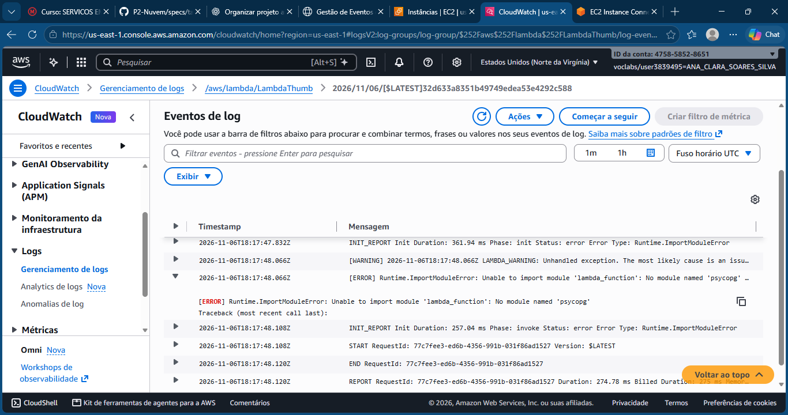

A captura registra um erro `Runtime.ImportModuleError`, identificado em 06/11/2026 durante a execução da função LambdaThumb.

A mensagem `No module named 'psycopg'` indica que a biblioteca necessária para a conexão com o PostgreSQL não estava disponível no ambiente de execução naquele momento.

O erro foi identificado durante o desenvolvimento. As execuções registradas no dia seguinte não apresentaram erros nas métricas consultadas.

## 2. LambdaThumb — Métricas do CloudWatch

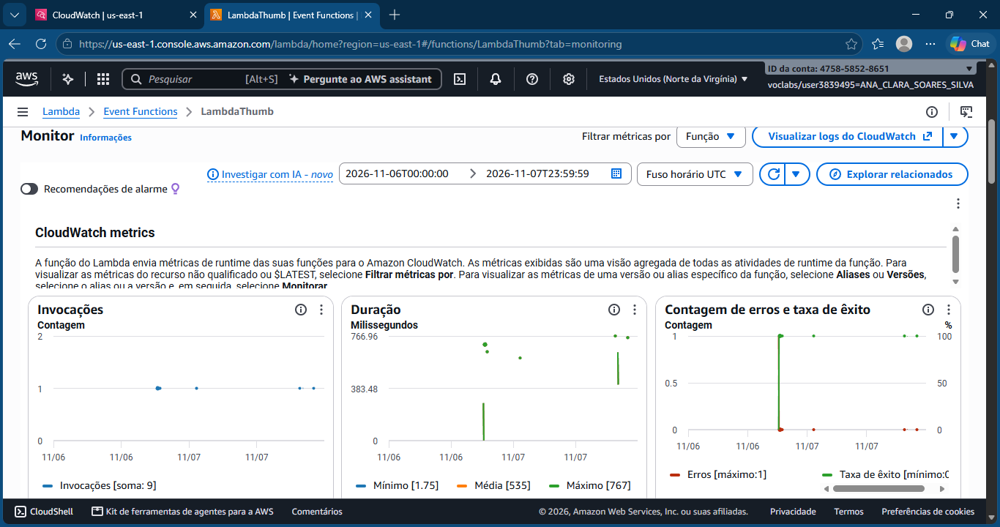

A captura apresenta o monitoramento de invocações e erros da função LambdaThumb.

Segundo as métricas consultadas no CloudWatch:

- **06/11/2026:** 4 invocações e 1 erro.
- **07/11/2026:** 5 invocações e nenhum erro.

Os registros demonstram a execução da função e permitem acompanhar os resultados após a falha identificada durante o desenvolvimento.

A geração e a visualização de uma miniatura WebP também foram validadas em testes posteriores da aplicação.

## 3. LambdaRelatorio — Métricas do CloudWatch

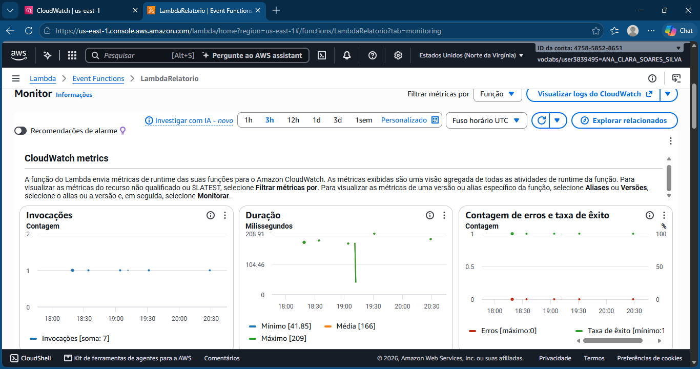

A captura registra o monitoramento da função LambdaRelatorio, responsável pela geração do relatório gerencial de utilização dos auditórios.

Durante a auditoria dos logs, foram identificados 51 registros `REPORT`, sem linhas correspondentes aos indicadores de erro pesquisados.

O endpoint `GET /relatorios/ocupacao`, disponibilizado pelo Amazon API Gateway, também foi testado com retorno HTTP 200.

## 4. Segurança do RDS — RNF-01

### Acesso público desabilitado
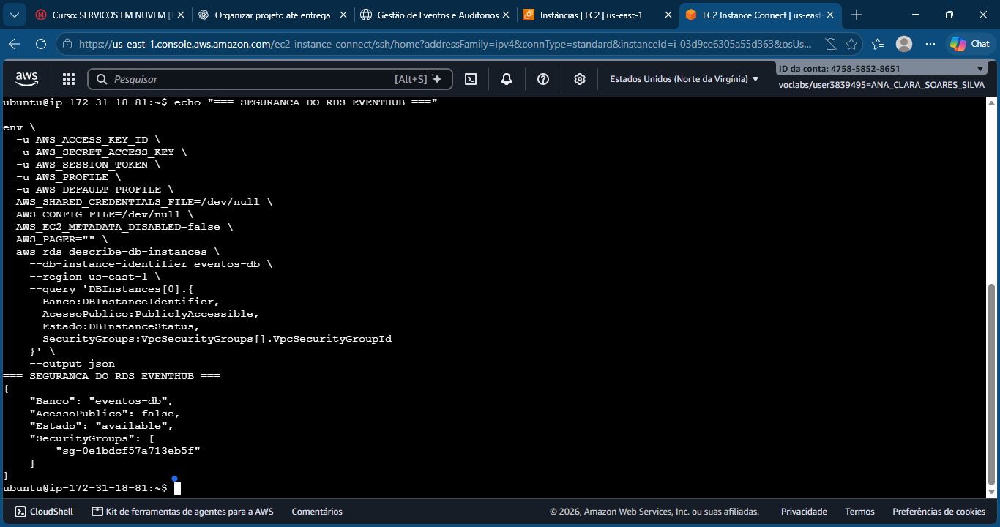

Consulta AWS CLI confirmando `PubliclyAccessible = false` para o banco `eventos-db`.

### Security Groups
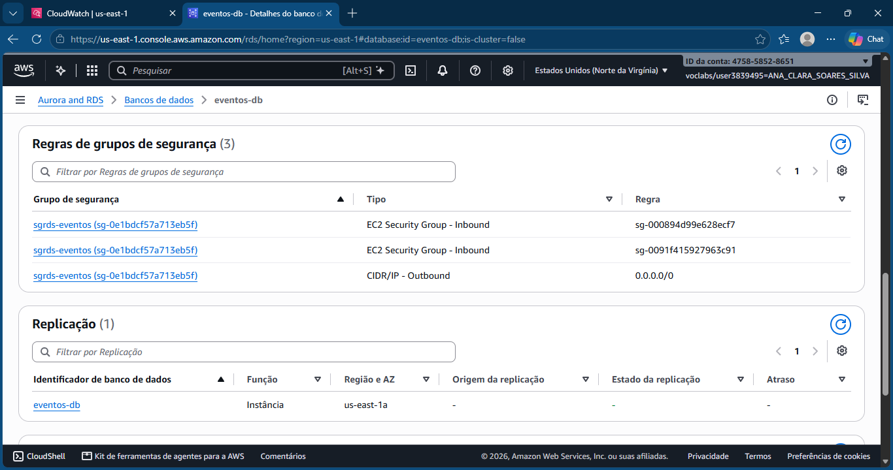

Regras de entrada do PostgreSQL restritas aos grupos autorizados da EC2 e das Lambdas.

### Subnets privadas
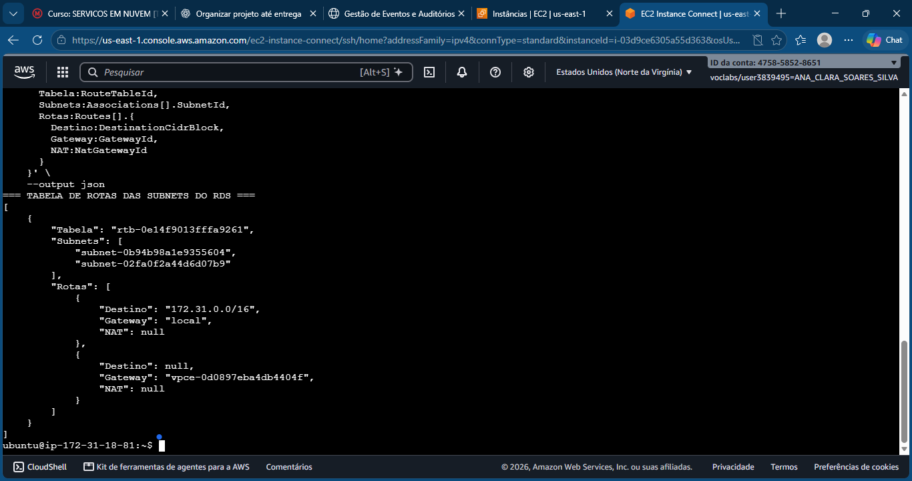

Tabela de rotas das duas subnets do RDS, sem rota direta para um Internet Gateway.

## 5. Segurança das evidências

As capturas de tela não devem apresentar senhas, chaves de acesso AWS, tokens de sessão ou outras credenciais sensíveis.

As evidências complementam os registros técnicos presentes no `README.md`, em `specs/infra.md` e em `specs/design.md`.

## 6. Amazon EC2 e Docker

### Instância EC2

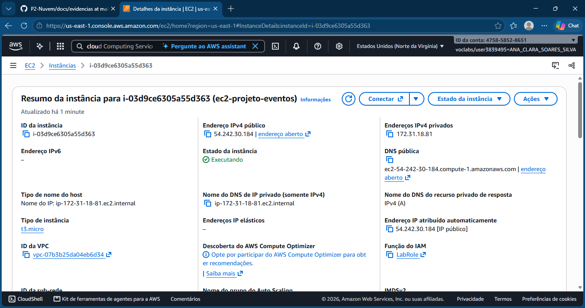

A captura apresenta a instância EC2 utilizada para hospedar a API principal do EventHub, identificada como `ec2-projeto-eventos`.

### Docker e funcionamento da API

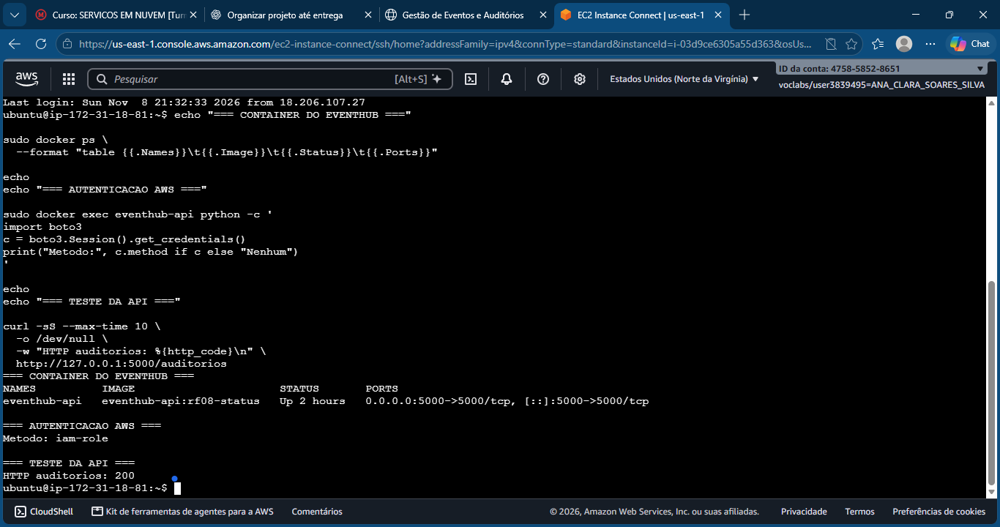

A evidência apresenta o contêiner `eventhub-api` em execução, utilizando autenticação automática pelo `LabRole` e respondendo às requisições da API.

## 7. Amazon S3

### Buckets do projeto

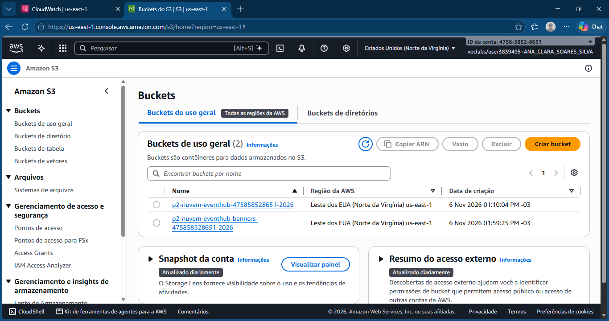

A captura demonstra a utilização de buckets separados para hospedagem do frontend e armazenamento dos banners e miniaturas.

### Hospedagem do frontend

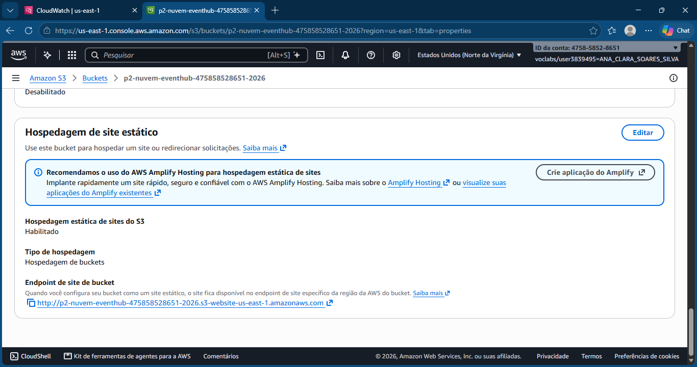

Apresenta a configuração de hospedagem estática do bucket responsável pela interface web do EventHub.

### Gatilho da LambdaThumb

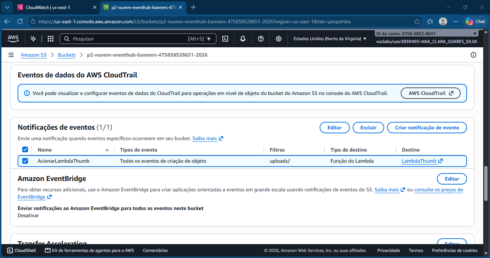

Demonstra a configuração do evento `ObjectCreated`, com prefixo `uploads/`, que aciona a função `LambdaThumb` quando novos banners são enviados ao bucket.

### Miniaturas processadas

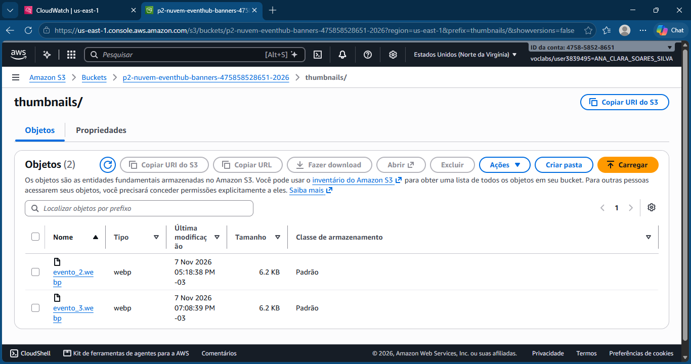

A captura apresenta os arquivos de miniaturas armazenados no S3 após o processamento das imagens.

## 8. Amazon API Gateway

### Rota de relatórios

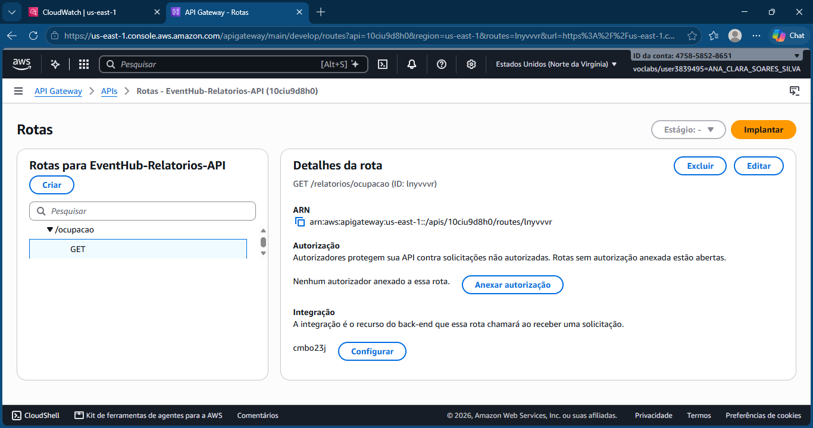

Apresenta a configuração da rota `GET /relatorios/ocupacao`, responsável por disponibilizar os dados do relatório gerencial.

### Integração com LambdaRelatorio

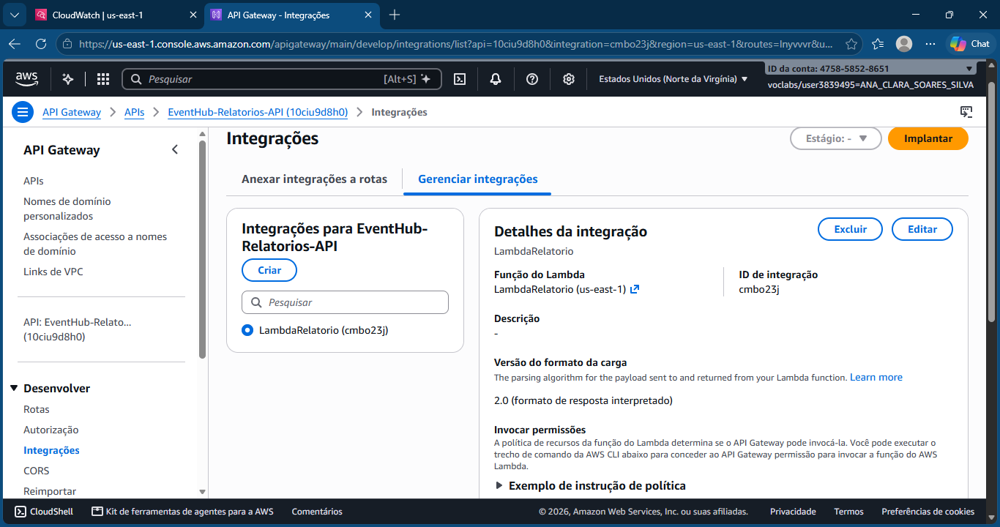

Demonstra que o API Gateway está integrado à função `LambdaRelatorio`.

### Teste do endpoint

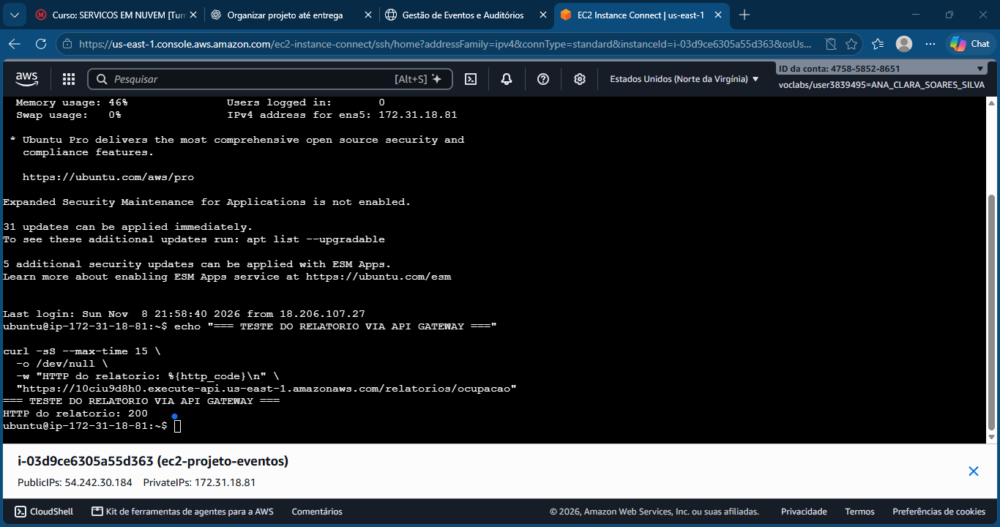

Registra o teste de acesso ao endpoint do relatório, utilizado para comprovar sua disponibilidade por meio de uma resposta HTTP 200.

## 9. Frontend do EventHub

### Visão geral

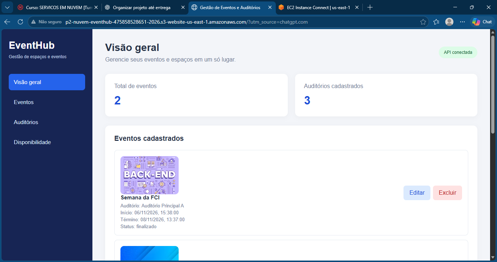

A captura apresenta o dashboard principal, com indicadores de eventos e auditórios, conexão com a API e visualização de banners.

### Gerenciamento de eventos

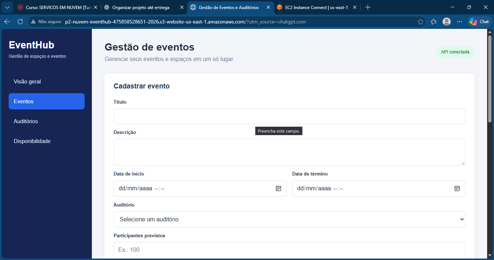

Demonstra a interface de gerenciamento dos eventos cadastrados, com informações de agendamento e operações disponíveis.

### Gerenciamento de auditórios

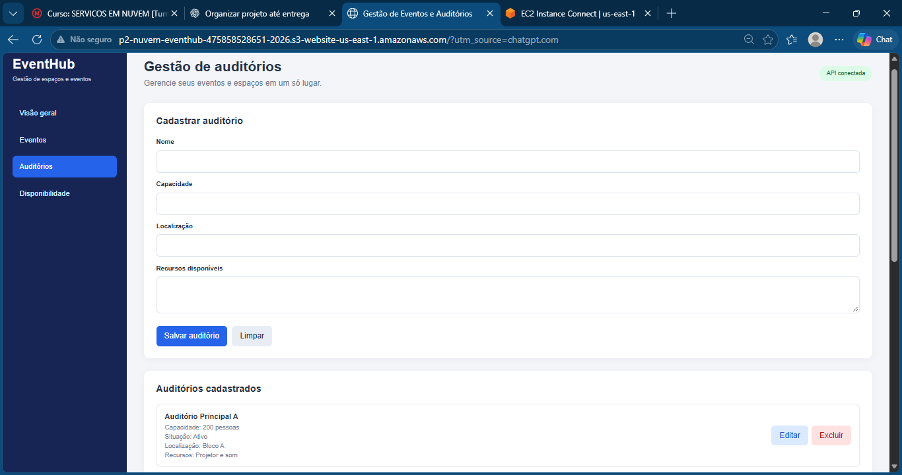

Apresenta a interface de cadastro e administração dos auditórios utilizados pelo sistema.

### Consulta de disponibilidade

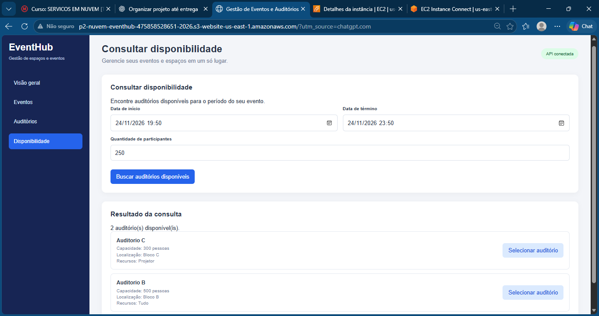

Demonstra uma consulta realizada para 250 participantes, no período de 24/11/2026, das 19h50 às 23h50, com dois auditórios disponíveis como resultado.

### Relatório gerencial

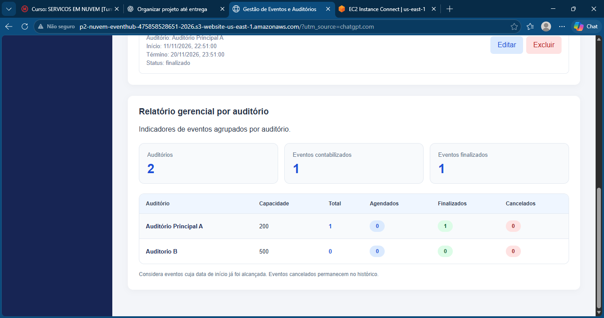

Apresenta os indicadores e as informações gerenciais obtidas por meio da integração entre o frontend, o API Gateway, a `LambdaRelatorio` e o RDS PostgreSQL.
